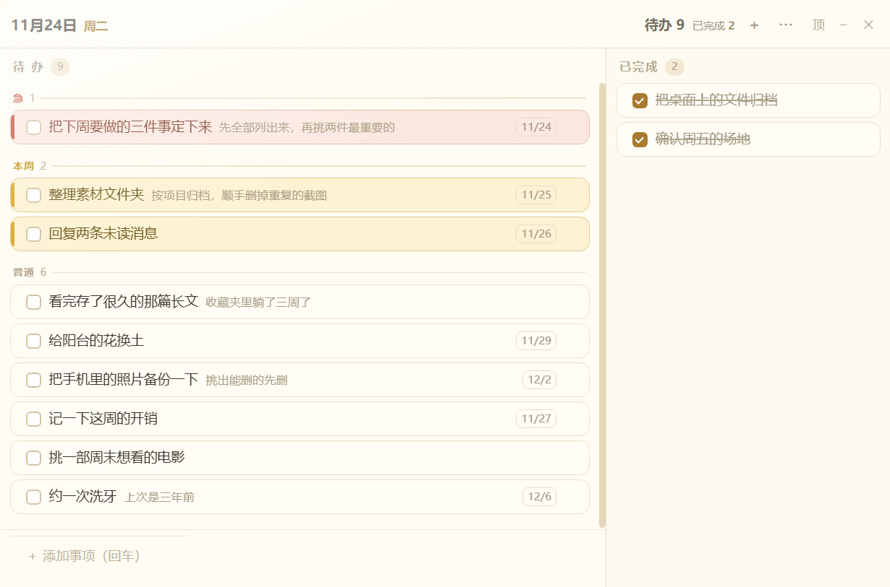

# 柒柒清单

> 贴在桌面上的置顶便签清单。左边待办，右边已完成，拖一下就换状态。

Windows 桌面小工具，一个独立窗口，默认置顶，可以随手拖到屏幕任何角落、随时拉大拉小。
界面是米黄便签纸的质感，不用登录、不联网、数据全在本机。



## 为什么做它

试过不少清单软件，最后都不用了，原因很一致：**状态和位置是分离的**。
勾完一条，它被划掉、变灰，但仍然赖在原地。于是「哪些做完了」要靠一遍遍往下翻，翻到最后就烦了，索性不看了。

这个工具只坚持一件事：**做完的东西应该离开你的视线**。
拖到右边，它就从待办里消失；拖回来，它又回来了。状态不是标签，是位置。

## 特性

- **两栏，拖一下就换状态**：左边待办，右边已完成。拖过去就算完成，拖回来就恢复，勾选框也能点。
- **中间的缝能拖**：按住两栏之间的分隔条左右拖，想让哪边宽就哪边宽；双击回到默认。宽度会记住，下次打开还是这个分配。
- **优先级用颜色分层**：卡片按「急 / 本周 / 普通」三段自上而下排列，整张卡染色，扫一眼就知道先做哪件。
- **单行卡片**：一条只占一行，事项和备注同一行显示，最长的那条自动省略。二十条一屏也放得下。
- **一直是桌面最上层**：默认置顶，顶栏的「顶」按钮可随时取消。
- **窗口随你摆**：拖动顶栏移动，拖四边缩放（最小 460×300），位置和大小下次打开还在原处。
- **顶栏只有今天的日期**：`11月24日 周二`，有超期未完成的会在前面标一笔红色。
- **不吃后台**：纯 HTML + 原生 JS，不用框架，内存占用就是 Electron 的基础开销。
- **数据在你手里**：存本机 `data` 目录，可一键导出 / 导入 JSON，不联网、无账号。

## 下载与使用

到 [Releases](../../releases) 下载最新的便携版 exe（文件名形如 `QiqiList-1.1.0-portable.exe`），放到任意文件夹（建议 D 盘），**双击即用**，不需要安装。

- 便携版是单文件 exe，第一次启动会解包到系统临时目录，约 1–2 秒，之后就快了。
- 数据写在 exe 同级的 `data` 目录里，想搬到别的电脑，连 `data` 一起拷走即可。
- 如果 exe 放在没有写权限的目录（比如 `C:\Program Files`），数据会自动退回 `%APPDATA%\QiqiList`。

## 交互

| 操作 | 效果 |
| --- | --- |
| 按住卡片拖到另一栏 | 换状态；落在哪个优先级区，就归到哪一组 |
| 点卡片左侧小勾 | 完成 / 取消完成 |
| 点卡片左侧彩色细条 | 循环切换 无 → 急 → 本周 |
| 点卡片右边的日期 | 选截止日；逾期会变红 |
| 双击文字 / 点「⋯」 | 改文字、写备注、设截止日、删除 |
| 卡片最右侧「＋」 | 在该位置新增一条 |
| 顶栏「＋」 | 快速添加（支持一次粘贴多行） |
| 顶栏「⋯」 | 导出备份、导入备份、清空已完成、关于 |
| 右键窗口 | 置顶开关、最小化、关闭 |

顶栏空白处按住就能拖动整个窗口；位置和大小会记住，下次打开还在原处。

## 数据

| 内容 | 位置 |
| --- | --- |
| 清单数据 | 浏览器 `localStorage`，落在 exe 同级 `data` 目录 |
| 窗口位置与大小、是否置顶 | `data/window.json` |

数据只在本机，**没有云同步**。换电脑请用「⋯ → 导出备份」，会存一个 JSON 到桌面，到新机器上「导入备份」。

## 开发

```bash
npm install
npm start          # 开发模式运行
npm run dist       # 打包成便携版 exe，输出到 dist/
node build/make-icon.js   # 重新生成图标（纯 Node 绘制，无第三方依赖）
```

国内网络建议指定镜像：

```bash
ELECTRON_MIRROR=https://npmmirror.com/mirrors/electron/ \
ELECTRON_BUILDER_BINARIES_MIRROR=https://npmmirror.com/mirrors/electron-builder-binaries/ \
npm install
```

## 目录结构

```
main.js                 主进程：窗口、置顶、位置记忆、单实例
preload.js              预加载脚本：只暴露最小的一组窗口控制接口
src/index.html          全部界面与逻辑（HTML + CSS + 原生 JS，单文件）
build/make-icon.js      图标生成脚本
build/icon.ico          应用图标
docs/screenshot.png     截图
```

界面刻意做成单文件，没有构建步骤、没有依赖，改一行 CSS 刷新就能看到效果。

## 已知限制

- 只有 Windows 版（打包脚本可用 `electron-builder --linux` / `--mac` 自行产出）。
- 单清单。这是设计选择：多清单会让你来回切换、互相遗忘，所以只保留一个总列表。
- 没有云同步、没有账号、没有协作。
- 没有开机自启和托盘，关掉窗口就退出。

## License

[MIT](LICENSE)
